<p align="center">
  
</p>

<h3 align="center">일반 업무 · 대학교 실습실 · 연구소 · FPGA/AI 연구실을 위한 가상 데스크톱(VDI) 플랫폼</h3>

<p align="center">
  
  <a href="LICENSE"></a>
  
  
</p>

---

> **MOAVI Desk는 100% 무료 오픈소스로 배포됩니다.** 엔진 · 콘솔 AGPL-3.0, Windows 클라이언트 MIT — 라이선스 비용 없이 설치하고, 고치고, 다시 배포할 수 있습니다. 유상은 구축 대행뿐입니다.

**MOAVI Desk** 은 Proxmox VE 위에서 동작하는 VDI 플랫폼입니다. 연구원·개발자·교육생·직원에게 데스크톱을 나눠 주고,
GPU·vGPU·FPGA 가속 카드를 필요한 만큼 빌려 쓰게 합니다. 이 저장소는 vLAB 의 **엔진(API 서버)** 입니다.
관리 콘솔과 사용자 작업 공간은 [makus-vlab-console](https://github.com/dskim1979/makus-vlab-console), Windows 클라이언트는 [moavi-desk](https://github.com/dskim1979/moavi-desk) 입니다.

<p align="center">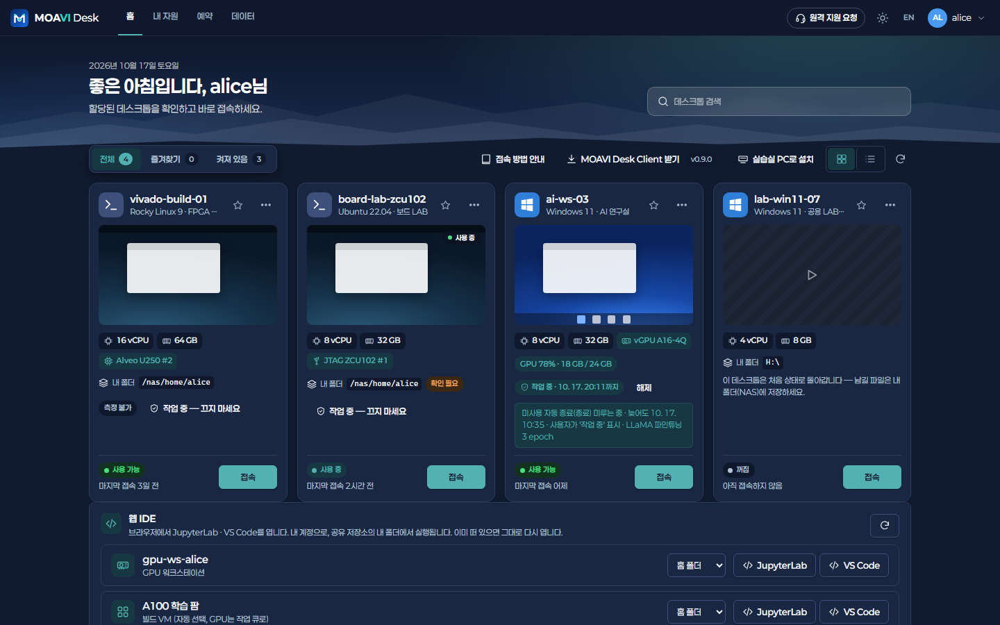</p>

| 관리 콘솔 대시보드 | GPU·가속 카드 재고 |
|---|---|
| 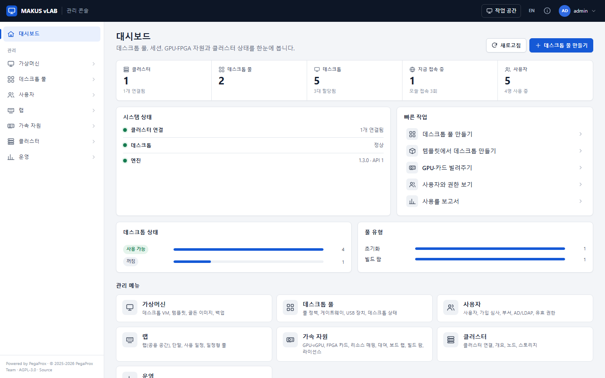 | 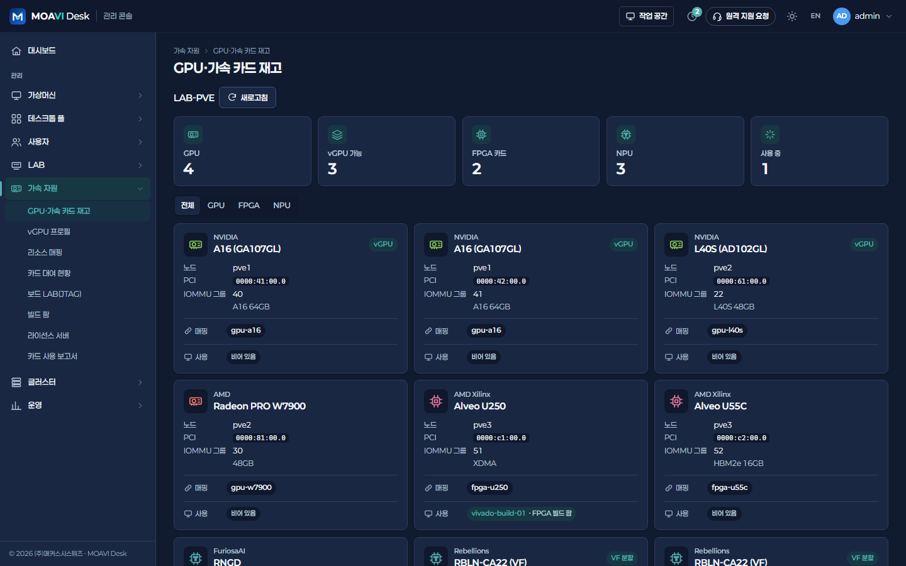 |
| **풀 이용 권한** (사용자 · 부서 · AD 그룹) | **접속 메뉴** (SPICE · RDP · 브라우저 RDP) |
| 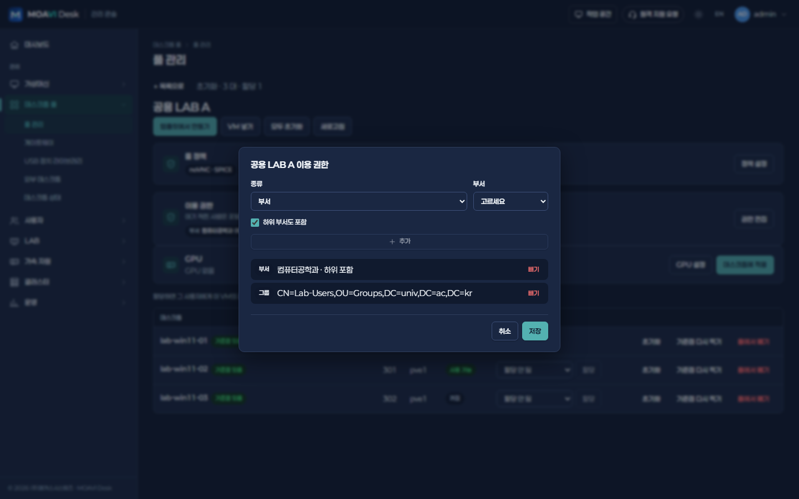 | 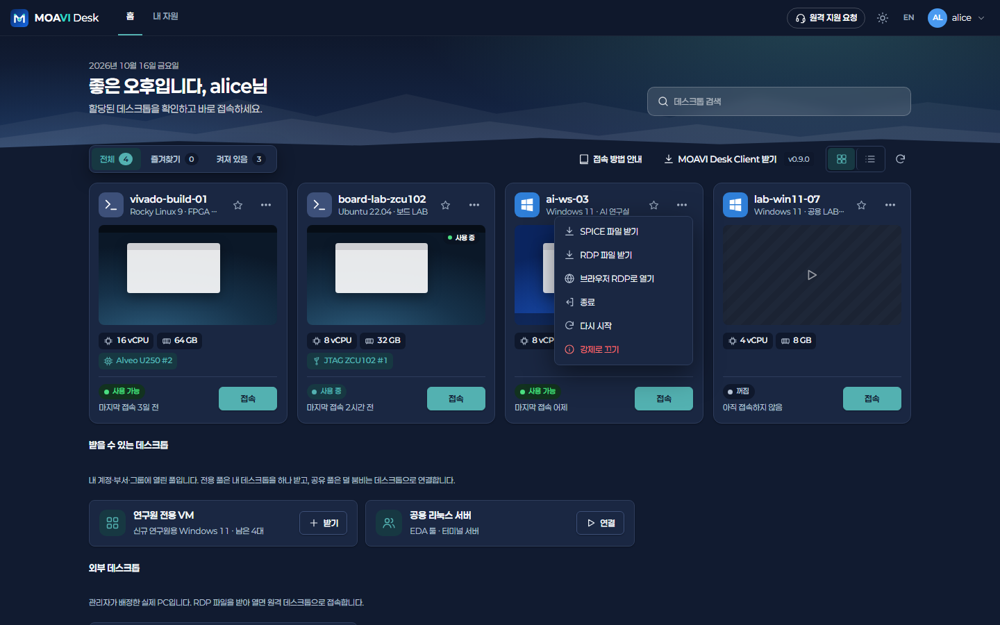 |
| **골든 이미지 일괄 교체** | **빌드 작업 큐** |
| 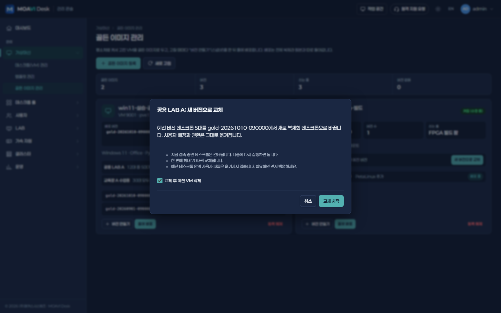 | 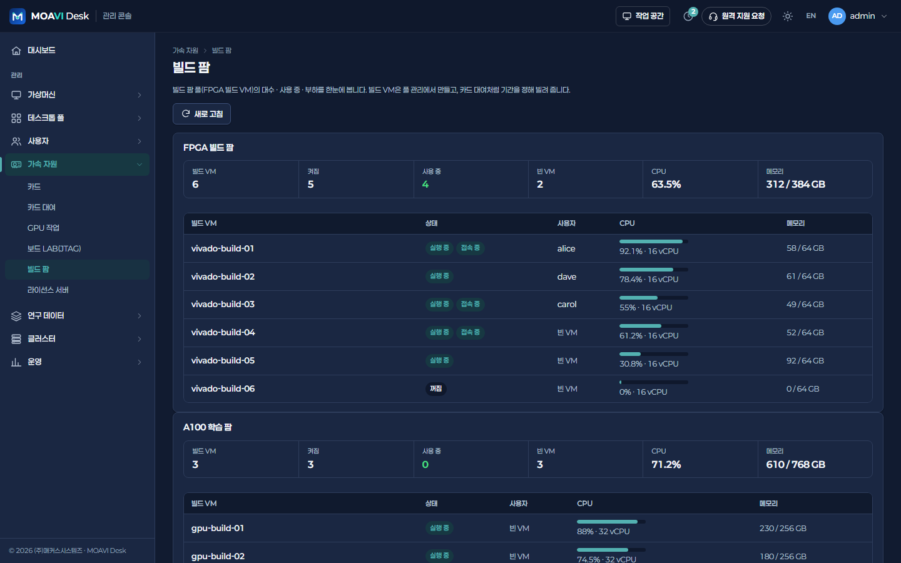 |
| **VM 관리 창** | **서포트 번들 (기간 지정)** |
|  | 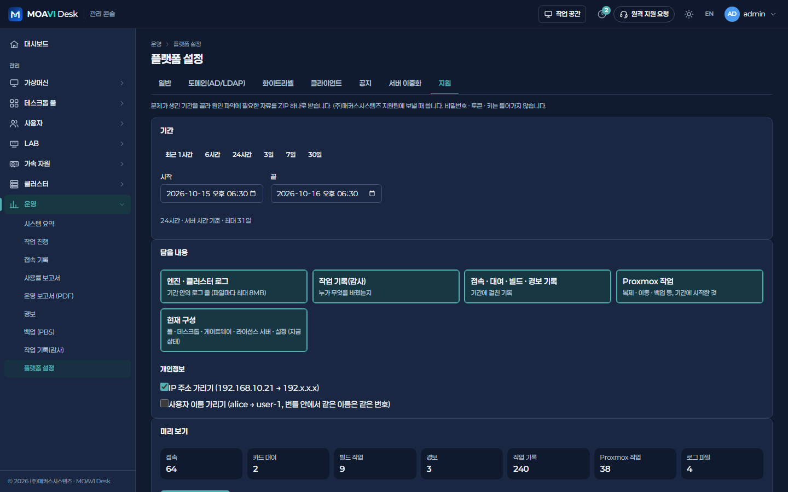 |
| **LAB 예약** | **단말 관리 (MOAVI Desk Agent)** |
| 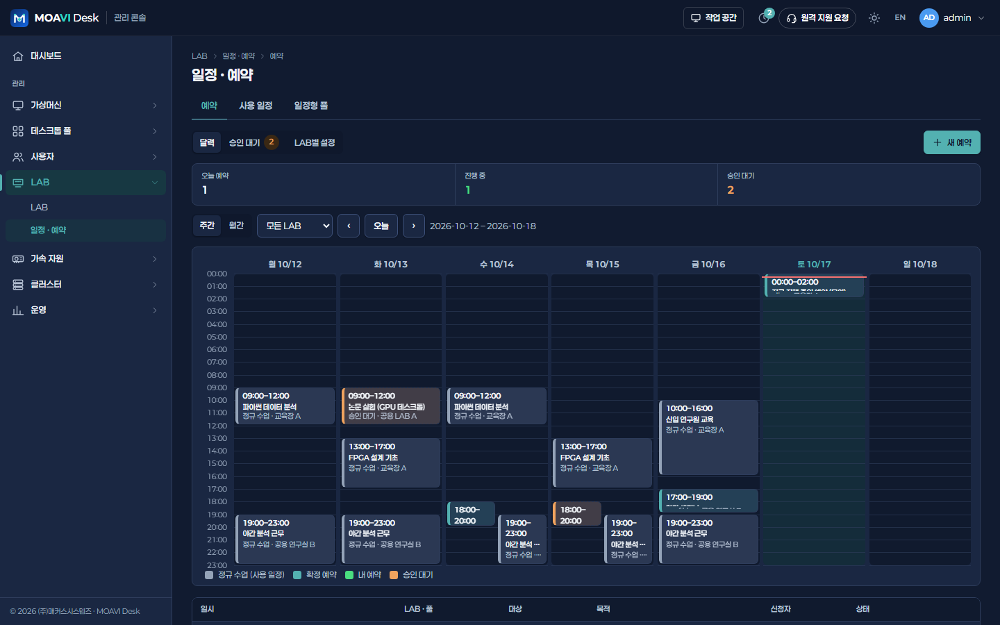 |  |
| **첫 설정 — 사이트 프로필** | **GPU 작업 큐** |
| 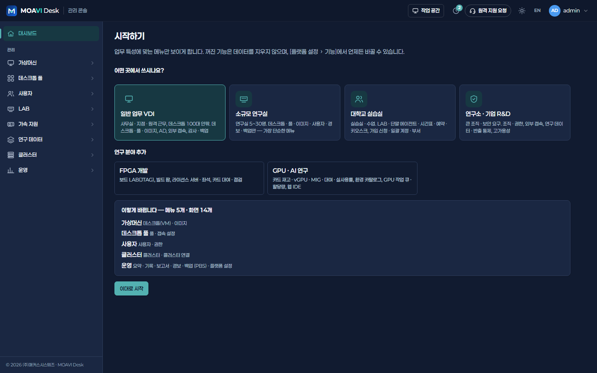 |  |
| **환경 카탈로그** | **연구 데이터셋** |
|  | 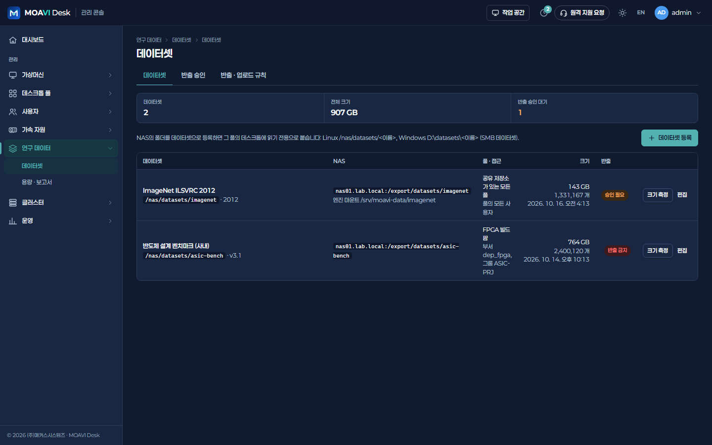 |

화면 전체는 [콘솔 저장소](https://github.com/dskim1979/makus-vlab-console#화면)에 있습니다.
사이트 종류별 안내: [일반 업무 VDI](https://github.com/dskim1979/makus-vlab-console/blob/main/docs/sites/general.md) · [대학교 실습실](https://github.com/dskim1979/makus-vlab-console/blob/main/docs/sites/university.md) · [연구소 · 기업 R&D](https://github.com/dskim1979/makus-vlab-console/blob/main/docs/sites/research.md) · [FPGA · AI 연구실](https://github.com/dskim1979/makus-vlab-console/blob/main/docs/sites/fpgaai.md).

## 주요 기능

사이트마다 쓰는 기능이 달라서, 처음 설정 때 **사이트 프로필**을 고르면 그에 맞는 메뉴만 보입니다(`pegaprox/vlab/features.py`,
`GET /api/vlab/features` · `PUT /api/vlab/admin/features`). 꺼진 기능 묶음은 화면에서 숨고 백그라운드 작업(LAB 일정 · 카드 회수 ·
라이선스 감시 · GPU 큐)도 돌지 않으며, 데이터는 그대로 남습니다.

| 프로필 | 켜지는 기능 묶음 |
|---|---|
| `general` 일반 업무 VDI (데스크톱 100대 안팎) | `org` 조직 · 권한, `external` 외부 접속 |
| `small_lab` 소규모 연구실 | (기본만) |
| `university` 대학교 실습실 | `lab` LAB · 단말 · 예약 · 키오스크, `signup` 가입 · 대량 계정, `org` |
| `research` 연구소 · 기업 R&D | `org`, `external`, `data` 연구 데이터, `ha` 고가용성 |
| 추가 묶음 | `fpga` FPGA 개발, `gpuai` GPU · AI 연구 |

아직 고르지 않았으면 모든 기능이 켜져 있습니다. 무인 설치는 환경 변수 `VLAB_PROFILE=university`, `VLAB_FEATURES=gpuai,fpga`로
처음 값을 정합니다(한 번만 적용, 이후는 콘솔 **운영 > 플랫폼 설정 > 기능**).

| 영역 | 내용 |
|---|---|
| 데스크톱 풀 | 전용·초기화·공유·일정형·빌드 팜 풀, 템플릿 일괄 복제(VMID·이름 자동), 풀 편집, 사용자 할당과 VM 권한 연동 |
| VM 관리 | VM 만들기(ISO · Windows 11은 UEFI/TPM 자동), ISO 업로드 · URL로 받기, 설정 · 디스크 · 네트워크 변경, 스냅샷, 노드 이동, 템플릿 변환, 삭제, 관리자 화면 열기(감사 기록) — 모두 VM별 권한(ACL) 검사 |
| 풀 권한 | 사용자 · 부서(하위 포함) · AD/LDAP 그룹 단위 이용 권한, 권한이 있으면 포털에서 직접 받기(전용 · 초기화 · 빌드 팜) |
| 초기화 · 골든 이미지 | 기준 스냅숏 자동 생성, 데스크톱·풀 단위 초기화(접속 중인 데스크톱은 건너뜀), 골든 이미지 버전 · 배포, 새 버전으로 일괄 교체(할당 · 권한 이전) |
| 접속 | 브라우저(noVNC), SPICE(`.vv`), RDP 파일(`.rdp`, 게스트 에이전트로 주소 조회), 브라우저 RDP(Guacamole · guacamole-auth-json 서명 링크), 공유 풀 접속 라우팅(가장 덜 붐비는 데스크톱 · 최대 접속), 접속 기록, 사용자 전원 제어 |
| 게이트웨이 · 외부 데스크톱 | RDP 게이트웨이 · MS RD 게이트웨이 · Guacamole 등록과 포트 확인(내장 Guacamole 자동 등록), 실제 PC를 사용자에게 배정 |
| GPU·vGPU | GPU 재고, NVIDIA vGPU 프로필, PCI 리소스 매핑, 풀 단위 GPU 정책(전체 GPU / vGPU), 머신 종류에 맞춘 슬롯(q35가 아니면 pcie=1 빼기), 카드 · 패스스루 점검(i440fx · SeaBIOS BAR · 벌루닝 · 자동 시작 · HA · AMD GPU 리셋 · vGPU 라이선스 · 같은 매핑 두 번), 카드가 있으면 메모리 포함 스냅샷 거부 |
| FPGA | AMD Xilinx·Intel FPGA 카드 인식, 카드 대여·연장·반납·자동 반납, 보드 LAB(JTAG USB 연결 · 대여 기간 · 자동 분리, Platform Cable USB II 펌웨어 전 ID 경고), Alveo 점검(PF0/PF1 기능 하나만 넘김 · 리셋 때 xclbin 지워짐), 빌드 작업 큐(빈 빌드 VM에서 차례로 실행), 카드별 사용 보고서(CSV) |
| 빌드 결과물 · CI | 작업이 끝나면 비트스트림 · 리포트 · 로그를 NAS `artifacts/<사용자>/<작업>`에 보관 · 내려받기(반출 규칙 적용), GitLab CI · Jenkins 연결(토큰 · `POST /api/vlab/ci/jobs` · 상태 · 결과물) |
| 카드 · 보드 예약 | 포털에서 GPU · NPU · FPGA 카드나 JTAG 보드를 내 데스크톱에 쓸 시간 예약(수량 · 대여 중 · 데스크톱 겹침 검사, 승인, 시작 때 자동 대여 · 끝에 반납) |
| 라이선스 서버 | FlexLM · vGPU 라이선스 서버 포트 자동 감시(5분), 끊김 · 복구 때 웹훅 · 메일 알림, 기능별 좌석 사용 · 대기 · 거절 |
| GPU · AI 연구 | 환경 카탈로그(OS · 드라이버 · CUDA · 툴체인 버전, 게스트에서 읽기, 호환표), NVIDIA MIG(레이아웃 · 모드, MIG vGPU 프로필), GPU 작업 큐(공정 분배 · 할당량 · 월 GPU-시간), 웹 IDE(JupyterLab · VS Code, vlab-proxy `/ide/`), GPU-시간 보고서, 실사용률과 유휴 카드 회수, 긴 작업 중 끄지 않기, 개인 알림 메일(작업 시작 · 종료, 할당량 80% · 100% — 부서는 책임자에게, 대여 종료 전 · 자동 반납, 웹 IDE 유휴 · 관리자 종료) |
| 연구 데이터 | 데이터셋(NAS 위치 · 풀 · 접근), 포털 파일 전송(이어 올리기 · 이어 받기), 반출 신청 · 승인 · 일회용 링크, 풀별 반출 · 업로드 규칙, 용량 · 반출 보고서(CSV) |
| LAB | LAB · 주간 시간표, 일정형 풀 준비 · 정리, 키오스크, LAB 예약(충돌 검사 · 승인 · 반복 · 참가자 · 자동 준비 · 노쇼 보고서), 단말 에이전트(MOAVI Desk Agent: 등록 코드 · 하트비트 · 키 자동 전달 · 1파일 설치) |
| 공유 저장소 | 풀마다 NFS(autofs) · SMB, 사용자별 home · project · scratch 폴더(엔진이나 사용자가 만들고 VM root는 쓰지 않음), Windows 로그온 드라이브, 빌드 작업은 scratch에서, 실패해도 접속은 막지 않음 |
| 사용자 | 로컬 계정 만들기 · 수정 · 삭제 · 비밀번호 · 2단계 인증 초기화 · 잠금 해제, 역할 관리, 내 계정(비밀번호 · TOTP · 받을 알림 메일), 계정 · 신청 알림(가입 승인 · 거절, 데스크톱 배정 · 초기화, 대여 · 반출 결과, 관리자의 비밀번호 · 2단계 인증 초기화는 항상), 관리자에게 가입 심사 대기 경보, AD/LDAP, 가입 신청(메일 확인 · 약관 동의) · 심사, 비밀번호 찾기, CSV 일괄 등록 · 계정 만료, 부서, 유효 권한 조회(권한이 어디서 왔는지) |
| 운영 | 대시보드, 시스템 요약, 작업 진행(Proxmox 작업 진행률 · 로그), 접속 끊기, 공지 배너, 사용률 보고서(일·풀·사용자별, CSV), 작업 기록(감사), 플랫폼 설정(폐쇄망 모드 포함), 서포트 번들(기간 지정 · 비밀 정보 제거 · IP/사용자 가리기) |
| 증설 예측 | 클러스터마다 하루 한 번 CPU · 메모리 · 스토리지 · 동시 접속 · 카드 사용을 쌓고 추세선으로 기준에 닿는 날 계산(대시보드) |
| 알림 | 사용자 메일(종류별로 끄기: GPU 작업 · 할당량 · 대여 · 웹 IDE · 데스크톱 배정 · 교체 · 이동 · 접속 끊김 · LAB 예약 시작 전 · NAS 90%/100% · 신청 결과, 보안 알림은 항상), 관리자 운영 알림(실습실 PC 승인 대기 · 서버 이중화 · 라이선스 거부 · 긴 작업 실패, `pegaprox/vlab/ops_notices.py`), 경보 채널 · 경보 메일 |
| 클러스터 | Proxmox 클러스터 연결, 노드·스토리지 개요, 노드 유지보수 · 재시작, Proxmox HA 리소스 · 그룹, MOAVI Desk 서버 이중화(활성 · 대기) |

## 구성

```
 사용자 브라우저 / MOAVI Desk 클라이언트 / LAB 키오스크
          │ HTTPS 443
 ┌────────▼──────────────┐  /api   ┌───────────────────────┐
 │ vlab-proxy (nginx)     │───────▶│ vlab-engine (이 저장소) │──── Proxmox VE 클러스터 :8006
 │ 콘솔 · 포털 정적 파일   │        │ API 전용 (WEB_UI=0)    │      (GPU·FPGA 노드, spiceproxy :3128)
 │ /guacamole/ ───────────┼──┐     └───────────────────────┘
 └───────────────────────┘  │
                ┌───────────▼──────────┐
                │ guacamole + guacd     │──── 데스크톱 RDP :3389 (브라우저 RDP)
                └──────────────────────┘
```

- 엔진은 Flask·gevent, 설정은 SQLite(SQLCipher). vLAB 기능은 `pegaprox/vlab/` 와 `pegaprox/api/vlab.py` · `pegaprox/api/vlab_next.py` (`/api/vlab/*`).
- 설치 묶음(docker compose, Guacamole 포함)은 콘솔 저장소의 `deploy/`.
- API 명세: [`docs/openapi.json`](docs/openapi.json)

## 빠르게 시작하기

설치 묶음(nginx·docker compose)은 콘솔 저장소의 `deploy/` 에 있습니다. 엔진만 띄우려면:

```bash
docker compose up -d --build
```

개발 환경에서 시험:

```bash
python3 -m venv .venv
.venv/bin/pip install -r requirements.txt -r requirements-dev.txt
.venv/bin/python -m pytest tests/test_vlab_api.py tests/test_vlab_accel.py -q
```

## GPU·FPGA 준비

GPU·FPGA 카드는 Proxmox 의 **리소스 매핑**(데이터센터 > 리소스 매핑 > PCI 장치)을 통해 데스크톱에 붙습니다.
같은 모델의 카드를 여러 노드에서 한 매핑에 넣으면, 데스크톱이 어느 노드에서 켜지든 빈 카드를 씁니다.
vGPU 는 NVIDIA vGPU 호스트 드라이버와 라이선스 서버(DLS/CLS)가 필요합니다.

## 기여·보안

- 기여 방법: [CONTRIBUTING.md](CONTRIBUTING.md)
- 보안 문제 신고: [SECURITY.md](SECURITY.md)

## 라이선스와 출처

MOAVI Desk 은 GNU Affero General Public License v3.0([LICENSE](LICENSE))으로 배포합니다.

이 엔진은 오픈소스 프로젝트 **PegaProx**(© 2025-2026 PegaProx Team, AGPL-3.0)를 바탕으로 (주)매커스시스템즈가
수정·확장한 버전입니다. AGPL-3.0 제7조(b)에 따른 저작자 표시는 [NOTICE](NOTICE) 에 있으며, 제품 화면의
"Powered by PegaProx" 표시와 저작권 고지는 라이선스상 지우거나 가릴 수 없습니다.
네트워크로 서비스하는 경우 제13조에 따라 사용자에게 소스 코드를 제공해야 합니다.

Proxmox 는 Proxmox Server Solutions GmbH 의 상표이며, NVIDIA·AMD·Intel·Xilinx 는 각 회사의 상표입니다.
